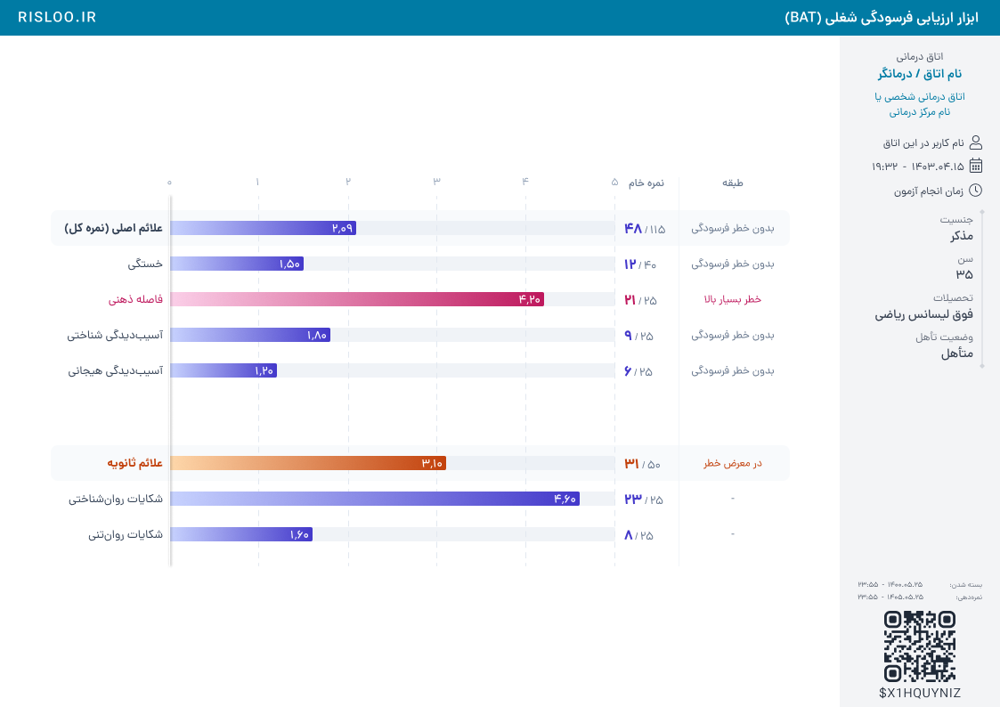
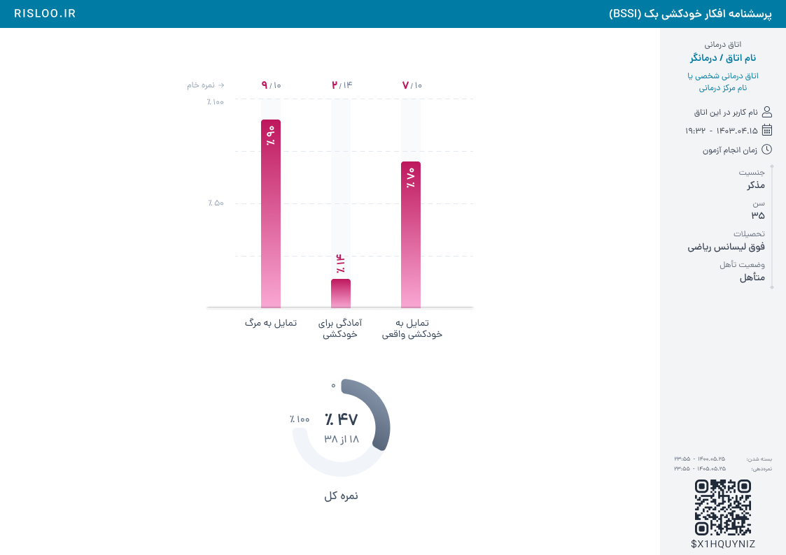
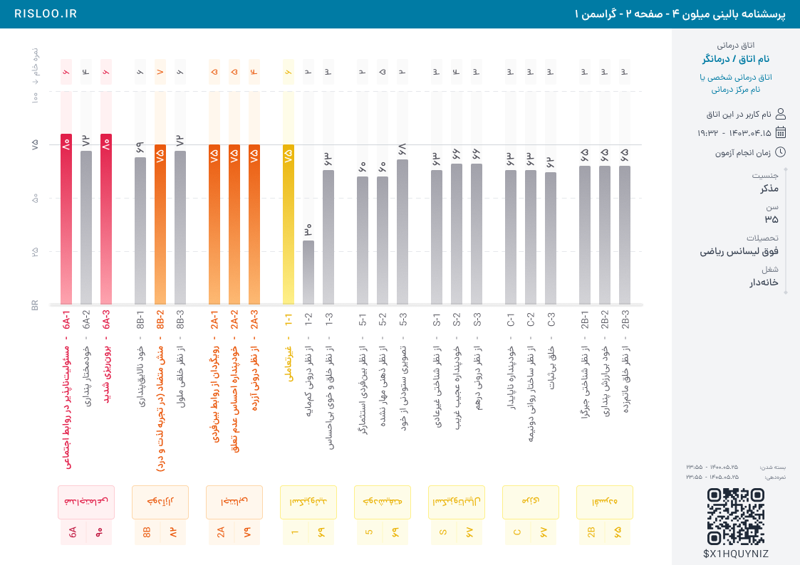

# قواعد خانوادهٔ میله‌ای و ستونی

تاریخ بررسی: `2026-10-11`. منبع: صفحهٔ Profiles در فایل Assessments v3.0.0 فیگما. این سند فقط قرارداد بصری است؛ نمره، هنجار، ترتیب بالینی، اعتبار و محاسبهٔ درصد را تعریف یا تغییر نمی‌دهد.

## مبنا و پوشش بررسی

طبق دستور طراح، جای پایین‌تر در **همان سکشن** نشانهٔ جدیدتر بودن طرح است. این ترتیب تاریخ انتشار آزمون نیست. صفحه‌های یک آزمون چندصفحه‌ای در کنار یا زیر هم، هرکدام کاربرد مستقل دارند؛ مثلاً صفحهٔ چهارم MCMI4 جایگزین سه صفحهٔ پیشین آن نیست.

- نمای کلی تمام **65 فریم Bar** و **18 فریم Column** بررسی شد؛ عددها تعداد فریم‌اند، نه تعداد آزمون مستقل. برای تمام آن‌ها ساختار و مختصات نیز در موجودی فیگما بررسی شد.
- 15 فریم در PNG مستقل با اندازهٔ طبیعی بازبینی شد: BAT، JSS، چهار صفحهٔ Strong، NEO-FFI گروسی، چهار صفحهٔ MCMI4، BSSI، BDI صفحهٔ 1، باورهای وسواسی قدیمی، MOCI قدیمی.
- اندازه‌گیری جزئی خصوصیات گره‌ها روی BAT، JSS، Strong صفحه‌های 1 و 4، MCMI4 و BSSI انجام شد. مشاهدهٔ کلی سایر فریم‌ها، ادعای اندازه‌گیری پیکسل‌به‌پیکسل تمام آن‌ها نیست.
- لایه‌های مخفی و نمونه‌های جایگزین درون فریم، معیار تصویری نیستند. برای مثال Strong و BSSI چند `Main` دارند؛ فقط حالت قابل مشاهده در PNG مبنای این بررسی است.
- نام سکشن تعیین‌کنندهٔ جهت نمودار نیست: MCMI4 صفحهٔ 4 در Column قرار دارد، اما نمودارش افقی است. 16pf در همین سکشن، نمایش جایگاه روی محور دارد؛ تبدیل آن به ستون مجاز نیست.

| نقش | مرجع | y در سکشن | کاربرد |
|---|---|---:|---|
| جدیدترین Bar | [BAT — 8072:262980](https://www.figma.com/design/Ev7eB2DQIWjRhIkFnqD38V/Assessments---v3.0.0?node-id=8072-262980) | 33752 | ردیف فشرده، گروه، نمرهٔ خام و طبقه |
| جدید Bar | [JSS — 8071:183988](https://www.figma.com/design/Ev7eB2DQIWjRhIkFnqD38V/Assessments---v3.0.0?node-id=8071-183988) | 32910 | ردیف فشرده، نشان نمره، نمرهٔ کل عمودی |
| جدید Bar دوقطبی | [Strong 1 — 7756:236677](https://www.figma.com/design/Ev7eB2DQIWjRhIkFnqD38V/Assessments---v3.0.0?node-id=7756-236677)، [2 — 7849:241908](https://www.figma.com/design/Ev7eB2DQIWjRhIkFnqD38V/Assessments---v3.0.0?node-id=7849-241908)، [3 — 7856:283263](https://www.figma.com/design/Ev7eB2DQIWjRhIkFnqD38V/Assessments---v3.0.0?node-id=7856-283263)، [4 — 7856:285112](https://www.figma.com/design/Ev7eB2DQIWjRhIkFnqD38V/Assessments---v3.0.0?node-id=7856-285112) | 32068 | دو جهت، گروه‌های زیربعد و شرح دو قطب |
| جدید Bar خلوت | [NEO-FFI گروسی — 5890:289567](https://www.figma.com/design/Ev7eB2DQIWjRhIkFnqD38V/Assessments---v3.0.0?node-id=5890-289567) | 31226 | پنج ردیف، عدد خام، طبقه و نوار اعتبار |
| جدید Column چندصفحه‌ای | [MCMI4 1 — 6131:229009](https://www.figma.com/design/Ev7eB2DQIWjRhIkFnqD38V/Assessments---v3.0.0?node-id=6131-229009)، [2 — 7438:219126](https://www.figma.com/design/Ev7eB2DQIWjRhIkFnqD38V/Assessments---v3.0.0?node-id=7438-219126)، [3 — 7469:222511](https://www.figma.com/design/Ev7eB2DQIWjRhIkFnqD38V/Assessments---v3.0.0?node-id=7469-222511)، [4 — 7559:229735](https://www.figma.com/design/Ev7eB2DQIWjRhIkFnqD38V/Assessments---v3.0.0?node-id=7559-229735) | 11868، 12710، 13552، 14394 | ستون بالینی متراکم و صفحهٔ افقی هشدارها |
| جدید Column کم‌تراکم | [BSSI — 5405:143397](https://www.figma.com/design/Ev7eB2DQIWjRhIkFnqD38V/Assessments---v3.0.0?node-id=5405-143397) | 11026 | سه ستون، نسبت خام بالا و نمرهٔ کل حلقه‌ای |
| مکمل Column | [BDI 1 — 5069:129333](https://www.figma.com/design/Ev7eB2DQIWjRhIkFnqD38V/Assessments---v3.0.0?node-id=5069-129333) | 7658 | ستون + نمرهٔ کل + هشدار + شرح |
| صرفاً مقایسهٔ تاریخی | [باورهای وسواسی — 3:14167](https://www.figma.com/design/Ev7eB2DQIWjRhIkFnqD38V/Assessments---v3.0.0?node-id=3-14167)، [MOCI — 3:11309](https://www.figma.com/design/Ev7eB2DQIWjRhIkFnqD38V/Assessments---v3.0.0?node-id=3-11309) | 80 در هر سکشن | تفاوت زبان قدیمی با زبان جدید |

## انتخاب زبان جدید

**اصلاح طراح پس از بازبینی RSSS93، ۲۰۲۶-۱۰-۱۱:** در یک طراحی میله‌ای، خط نازک و نقطهٔ نمره جایگزین میله‌های رنگیِ BAT/JSS نیست. برای نمونهٔ فعلی RSSS93، همین زبان میله، گرادیان، track و تراز مشترک ملاک است؛ بدون انتقال دامنه یا طبقه‌بندی آزمون مرجع. توضیحات و تیترهای غیرضروری حذف می‌شوند، نمودار باقی‌مانده وسط قرار می‌گیرد، برچسب عمومی مجموع «نمره کل» است و صفرهای انتهایی اعشار نمایش داده نمی‌شوند. متن کامل و استثناهای این پیش‌فرض‌ها در **VIS-25 تا VIS-29** در [راهنمای اصلی](../README.md) ثبت شده‌اند.

### BAR-01 — نمودار به‌صورت ستون‌های تراز اطلاعات خوانده شود

در BAT، JSS، NEOهای پایین سکشن و MCMI4 صفحهٔ 4، عنوان‌ها، نمودار، نمرهٔ خام و طبقه خانواده‌های تراز مستقل دارند. طول عنوان یا عدد، مبدأ نوار و محل ستون بعدی را جابه‌جا نمی‌کند. عنوان فارسی در سمت چپ نوار قرار دارد و لبهٔ راست عنوان‌ها مشترک است؛ RTL به معنی انتقال خودکار همهٔ عنوان‌ها به سمت راست نمودار نیست.

نمونهٔ اندازه‌گیری: BAT در گره `8072:262983` عنوان‌ها در `x=126` تمام می‌شوند، نوار در `x=134` آغاز و در `634` تمام می‌شود. ستون خام از `644` آغاز می‌شود؛ جداکننده در `705` و جعبه‌های طبقه در `718..814` قرار دارند. فاصلهٔ عنوان تا نوار **8px** و نوار تا ستون خام **10px** است. این مختصات متعلق به BAT است؛ قانون عمومی، مالکیت مستقل ستون‌ها و تراز مشترک است.

### BAR-02 — ضخامت و ریتم را متناسب با تراکم، از نمونهٔ هم‌نوع بگیر

| الگو | ضخامت نوار | فاصلهٔ شروع دو ردیف | انتهای گرد | نمونه |
|---|---:|---:|---:|---|
| جدول فشرده | 16px | 40px | 2px | BAT، JSS، MCMI4 صفحهٔ 4 |
| دوقطبی خلوت | 24px | 56px | 4px | Strong صفحهٔ 1 |
| دوقطبی همراه شرح | 24px | 128px | 4px | Strong صفحهٔ 4 |

عددهای جدول قرارداد نمونه‌های دیده‌شده‌اند، نه اندازهٔ اجباری همهٔ آزمون‌ها. ردیف فشردهٔ 16/40 دارای 24px فاصلهٔ خالی میان خود نوارهاست. شرح چندخطی را با کوچک‌کردن فاصلهٔ خطوط در همین فضای 24px جا نده.

### BAR-03 — فقط انتهای رشد نوار گرد باشد

BAT و JSS شعاع گوشه‌ها به ترتیب چپ‌بالا، راست‌بالا، راست‌پایین، چپ‌پایین برابر `[0,2,2,0]` است. Strong سمت مثبت `[0,4,4,0]` و سمت منفی `[4,0,0,4]` است. محل اتصال به مبنا صاف باقی می‌ماند. شعاع track و fill نیز با جهت متناظر هماهنگ است. در پیاده‌سازی از هندسهٔ گوشه‌های مستقل استفاده شود.

### BAR-04 — گرادیان از مبنای روشن به انتهای تیره حرکت کند

JSS روشنِ `#99F6E4` را در آغاز و `#0F766E` را در انتها دارد. Strong منفی در سمت چپ تیره و نزدیک مبدأ راست روشن است؛ بنابراین جهت گرادیان همراه جهت رشد تغییر می‌کند. گرادیان را به رنگ ثابت، چند قطعهٔ رنگ یا گرادیان عمودی تبدیل نکن، مگر همان طرح چنین باشد.

### BAR-05 — مقدار داخل نوار با انتها حرکت کند

در نوار 340px از JSS، جعبهٔ متن در `x=310,width=26` است و لبهٔ انتهایی متن دقیقاً **4px** پیش از انتهای نوار قرار می‌گیرد. همان 4px در BAT و MCMI4 صفحهٔ 4 تکرار می‌شود. مقدار داخل نوار سفید، با DanaFaNum Medium اندازهٔ 13 است. عدد را به وسط کل نوار یا به ستونی ثابت منتقل نکن.

### BAR-06 — مقدار بیرون نوار از انتها فاصله بگیرد و هم‌رنگ نوار شود

MCMI4 صفحهٔ 4: نوار 13٪ به عرض `52`، متن در `x=58`؛ نوار 17٪ به عرض `68`، متن در `x=74`؛ **فاصلهٔ بیرونی 6px** است. رنگ متن بیرونی `#0369A1` است و متن داخلی سفید. صفر نیز برچسب مستقل در فاصلهٔ 6px از مبدأ دارد. در Strong فاصلهٔ داخل و بیرون **6px** است؛ سمت منفی به‌صورت قرینه اجرا می‌شود.

وجود 13٪ و 17٪ بیرونی و 33٪ داخلی در یک تصویر، آستانهٔ دقیق تعویض را اثبات نمی‌کند. آستانهٔ ارائه باید در قرارداد همان نمودار ثبت شود؛ از روی یک نمونه، «زیر 20٪» یا «زیر 30٪» را قانون عمومی نکن. در گراسمن حتی عدد 72 بیرون نوار بلند دیده می‌شود؛ داخل/بیرون ممکن است علاوه بر طول، به حالت نمایشی وابسته باشد.

**تکمیل صریح طراح، ۲۰۲۶-۱۰-۱۱:** [عامل C در مرجع NEO](https://www.figma.com/design/Ev7eB2DQIWjRhIkFnqD38V/Assessments---v3.0.0?node-id=5850-135476) نوار `105px` و عدد بیرونی در `x=111` دارد؛ فاصله از انتها **6px** و رنگ عدد برابر انتهای تیرهٔ گرادیان است. قرارداد قدیمی RSSS دربارهٔ محور خطی ۰ تا ۵ و بیرون‌رفتن عددِ کمتر از ۱، با دستور صریح کاربر در ۲۰۲۶-۱۰-۱۳ منسوخ شد. RSSS93 اکنون نگاشت اختصاصیِ نمرهٔ ۱ به عرض `40px` و عدد همیشه داخل میله دارد؛ قرارداد کامل و دامنهٔ محلی این استثنا در [VIS-30](../README.md#vis-30--جای-عدد-را-تغییر-دهید-نه-طول-واقعی-میله-را) ثبت شده است.

### BAR-07 — track، پس‌زمینهٔ ردیف و پس‌زمینهٔ سطح، سه نقش متفاوت‌اند

- BAT: track برابر `#E2E8F0` با opacity **0.5**؛ ردیف برجسته `#F8FAFC` با شعاع **8px** و اندازهٔ `830×40`.
- JSS: track سیاه با opacity **0.04** روی پس‌زمینهٔ بسیار روشن سبزآبی؛ این مقدار را با «خاکستری ظاهراً مشابه» جایگزین نکن.
- MCMI4 صفحهٔ 4: پس‌زمینهٔ یکی‌درمیان `737×40` با `#F8FAFC` و شعاع **8px**، از عنوان تا نمرهٔ خام امتداد دارد.

در BAT فقط ردیف سرگروه‌های اصلی و ثانویه زمینه دارند؛ قاعدهٔ یکی‌درمیان MCMI4 را به BAT تعمیم نده. ردیف‌های بدون fill ممکن است در فیگما شعاع تعریف‌شده داشته باشند؛ این شعاع اثری در PNG ندارد و نباید به کارت قابل مشاهده تبدیل شود.

### BAR-08 — فاصلهٔ گروه‌ها باید از فاصلهٔ ردیف‌ها واضح‌تر باشد

BAT گروه اول پنج ردیف `40px` دارد (`y=37..237` برای پس‌زمینه‌ها)، گروه دوم در `y=301` آغاز می‌شود؛ فاصلهٔ بین bounds دو گروه **64px** است. سرگروه Bold است و زیردسته‌ها Regular. خطوط مقیاس و مبدأ در دو گروه ادامه دارند؛ جداکردن معنایی گروه‌ها، دلیل تغییر طول محور یا مبنای آن نیست.

**اقتباس اختصاصی RSSS93، ۲۰۲۶-۱۰-۱۳:** طبق ردیف «نمره‌های مولفه‌ها» در مستند تأییدشده، فراطبیعی دو ردیف، بین‌فردی یک ردیف و درون‌فردی سه ردیف دارد؛ نمرهٔ کل بیرون دسته‌ها می‌ماند. ظاهر از [گرهٔ 387:79429](https://www.figma.com/design/Ev7eB2DQIWjRhIkFnqD38V/Assessments---v3.0.0?node-id=387-79429) در [قاب MACI، 364:81952](https://www.figma.com/design/Ev7eB2DQIWjRhIkFnqD38V/Assessments---v3.0.0?node-id=364-81952) اقتباس شده: کارت خنثی به عرض `48px`، شعاع بیرونی `4px`، زمینهٔ `#F9FAFB`، حاشیهٔ `#F3F4F6` و عنوان وسط‌چین 13 Regular به رنگ `#4B5563` با چرخش `−90°`. با اصلاح کاربر در ۲۰۲۶-۱۰-۱۳، ارتفاع‌های RSSS برابر `72/80/104px` شد: کارت فراطبیعی در بالا و پایین میله‌های عضو `8px` و کارت درون‌فردی `4px` فاصله دارد؛ کارت تک‌عضوی بین‌فردی ارتفاع `80px` و ردیف وسط‌چین خود را حفظ می‌کند. فاصلهٔ کارت‌ها با اصلاح کاربر در ۲۰۲۶-۱۰-۱۳ به `32px` کاهش یافت؛ فاصلهٔ اولیهٔ مرجع `44px` بود: کارت اول `y=22..142` و آغاز کارت بعد `22+164=186`. این اقتباس در Chart برابر `650×430` با گام ردیف `40px` و نگاشت پذیرفته‌شدهٔ میله‌ها اجرا می‌شود؛ ابعاد آن قاعدهٔ عمومی دیگر نیم‌رخ‌ها نیست.

### BAR-09 — نمرهٔ خام و درصد/مقدار استاندارد نقش جدا دارند

JSS درصد را در نوار و خام را در نشان ثابت می‌گذارد: نشان **32×16px**، شعاع **4px**، stroke **1px** `#059669`، متن 13 Medium به رنگ `#047857`؛ فاصلهٔ انتهای track تا نشان **13px** است. عنوان «نمره خام از 20» بالای همان ستون است.

BAT به‌جای نشان، نسبت آزاد خام/سقف دارد: خام 16 Bold، سقف 13 Regular، `/` کم‌رنگ‌تر و فاصلهٔ بین اجزای گروه **2px**. مقدار خام رنگ حالت را می‌گیرد، سقف `#64748B` باقی می‌ماند. این دو الگو را در یک نمودار بدون دلیل مخلوط نکن. نوشتار درصد یا نسبت باید یک قطعهٔ جهت‌دار قابل آزمون باشد. این مشاهدهٔ عنوان JSS مجوز افزودن تیتر عمومیِ زائد به نمودار تازه نیست؛ فقط برچسب لازم برای تمایز دو نوع مقدار مطابق VIS-26 باقی می‌ماند.

### BAR-10 — طبقه در ستونی ثابت، مستقل از طول عدد خوانده شود

BAT جعبهٔ طبقهٔ **96×18px** دارد و متن 12 Regular در مرکز آن است. برای ردیف فاقد طبقه، خط تیره در همان ستون دیده می‌شود؛ حذف محتوای این ردیف نباید ستون خام، عنوان یا طول نوار را جابه‌جا کند. رنگ طبقهٔ هشدار با همان ردیف هماهنگ است. نام یا مرز طبقه از تصویر قابل بازتعریف نیست.

### BAR-11 — خطوط کمکی ظریف، مبدأ مشخص و سایه محدود باشد

JSS و BAT خط راهنما **1px**، رنگ `#E2E8F0`، dash `[6,6]` دارند. متن محور 12 Regular به رنگ `#94A3B8` است. محور صفر از این راهنماها جداست: خط سفید **پیوسته** 1px با سرگرد، opacity گروه **0.5** و سایهٔ مشکی `radius=3, offset=(1,0), spread=0`. در SVG، شعاع یادشده به `stdDeviation=1.5` تبدیل می‌شود. خط بعد از نوارها رسم شود و خط‌چین دیگری زیر آن نباشد. طبق تأکید طراح در ۲۰۲۶-۱۰-۱۱ و [نمونهٔ JSS](https://www.figma.com/design/Ev7eB2DQIWjRhIkFnqD38V/Assessments---v3.0.0?node-id=8071-183989)، سایهٔ خط عمودی صفر باید در خروجی نهایی **به راست** بیفتد؛ چرخش گره نباید جهت آن را عوض کند. محدودهٔ فیلتر را با طول خط تطبیق بده و جهت سایه را در PNG کنترل کن. سایه متعلق به مبناست، نه همهٔ نوارها یا همهٔ ردیف‌ها.

### BAR-12 — عدد محور را با راهنمای خودش تراز کن

درصدهای 0، 50 و 100، لبه یا مرکز یکسانی ندارند مگر تصویر همان را نشان بدهد. در BAT tickهای 0 تا 5 با راهنماهای 100px هماهنگ‌اند؛ در JSS پهنای track `400px` و فاصلهٔ راهنماهای فرعی `40px` است. محور BAT «میانگین» 0 تا 5 است و محور JSS درصد؛ عدد انتهای محور، تعداد tickها و ضریب پیکسل را بین آن‌ها کپی نکن.

### BAR-13 — نمرهٔ کل می‌تواند نمودار مستقل با سلسله‌مراتب خنثی باشد

JSS در سمت راست، نوار کل **18×350px** با track `#F1F5F9` و گرادیان `#94A3B8→#334155` دارد. عدد اصلی 18 DemiBold `#334155`، خط خام زیر آن 12 Regular `#64748B` است. عنوان کنار مبنا و عمود دیده می‌شود، اما گروه عدد خوانا و افقی است. نه همهٔ عناصر را با هم بچرخان، نه برای جاگرفتن کل صفحه scale کن. مبنای این نوار سایهٔ مخصوص خود با radius 6 و stroke 2 دارد؛ سایهٔ 3px نمودار ردیفی را خودکار جایگزین نکن.

با تأیید طراح در ۲۰۲۶-۱۰-۱۱، همین پالت خنثی برای ردیف افقی «نمره کل» RSSS هم به کار می‌رود؛ استفاده از رنگ نمونه، مستلزم تغییر جهت نوار یا رنگ خرده‌مقیاس‌ها نیست. گرادیان در جهت پرشدن نوار قرار می‌گیرد و رنگ آن به مقدار نمره وابسته نیست. در گرهٔ مرجع `8071:184056`، تبدیل گرادیان `0.57` است؛ برای حفظ شدت رنگ همان نمونه، طول بردار گرادیان حدود `1/0.57 = 1.754386` برابر طول نوار است. این اندازه مخصوص همین نمونه است، نه قاعدهٔ عمومی همهٔ نمره‌های کل.

### BAR-14 — محور دوقطبی، دو مبدأ و یک ناحیهٔ عنوان میانی دارد

Strong صفحهٔ 1: هر نیمهٔ track **250px**، ناحیهٔ عنوان **150×24px**، راست از `x=482` به راست و چپ تا `x=330` به چپ می‌رسد. عنوان بین دو خط پایه است و عرض متن آن **126px** با inset افقی **12px** است. سمت مثبت سبز و سمت منفی صورتی در این صفحه‌اند. مرکز را با یک نوار پیوسته که از زیر عنوان رد شود جایگزین نکن. صفر در هر سمت با همان دستگاه مختصات و برچسب خودش بررسی شود.

### BAR-15 — رنگ دو قطب وابسته به کاربرد همان صفحه است

Strong صفحهٔ 1 و زیربعدهای صفحه‌های 2 و 3: مثبت `#BBF7D0→#15803D`؛ منفی با انتهای بیرونی `#BE123C` و ابتدای نزدیک مبدأ `#FECDD3`. صفحهٔ 4 از خانوادهٔ بنفش استفاده می‌کند؛ سمت راست `#C7D2FE→#4338CA` اندازه‌گیری شد. سبز/صورتیِ صفحات رغبت را قانون «خوب/بد» برای سبک شخصی نکن. جهت منفی نیز به معنای تشخیص بالینی نیست.

### BAR-16 — شرح دو قطب دقیقاً زیر نیمهٔ مربوط قرار بگیرد

Strong صفحهٔ 4 زیر هر نوار، توضیح همان سمت را در زمینهٔ روشن همان نیمه قرار می‌دهد؛ عنوان همچنان در ستون وسط می‌ماند. ریتم ردیف **128px** است، نه 56px صفحهٔ اول. متن شرح در قالب یک بلوک چندخطی تراز می‌شود و فضای آن با طول تصادفی عنوان تغییر نمی‌کند. در صفحات 2 و 3، کارت سرگروه در بیرون ناحیهٔ دو قطب و کنار مجموعهٔ زیردسته‌های مربوط قرار دارد. این شاهد، قرارداد چیدمانِ شرح در همان نمونه است؛ اضافه‌کردن شرح اختیاری به آزمون دیگر را تجویز نمی‌کند. ضرورت شرح در ساخت یا بازطراحی بعدی با VIS-25 سنجیده می‌شود.

### BAR-17 — تغییرات تاریخی را با پیش‌فرض جدید اشتباه نگیر

بالای Bar، رنگ‌های متعدد برای هر ردیف، انتهای بسیار گرد، عنوان داخل بخش رنگی، کد داخل دایره و عدد در بالای انتهای نوار دیده می‌شود. پایین Bar، نوارهای تخت‌تر با گوشهٔ کوچک، گرادیان، عنوان خارج نوار، ستون خام مستقل و راهنمای کم‌رنگ غالب‌اند. برای طراحی جدید هم‌نوع از الگوی پایین آغاز کن. در بازطراحی، وجود شیوهٔ قدیمی در فایل مجوز حفظ خودکار آن به‌عنوان قاعدهٔ عمومی نیست؛ معنای داده و استثنای آزمون همچنان باید حفظ شود.

## قواعد ستون‌ها و صفحات بالینی

### COL-01 — ستون‌ها از مبنای مشترک رو به بالا رشد کنند

BSSI سه track هم‌اندازهٔ **28×300px** با فاصلهٔ مرکز تا مرکز **100px** دارد. کف هر سه ثابت است؛ تغییر نمره فقط ارتفاع fill را تغییر می‌دهد. track `#F8FAFC` و fill `#F9A8D4→#BE185D` از روشن در پایین تا تیره در بالا است. گوشه‌های پایین صاف و گوشه‌های بالایی **4px** هستند. این هندسه الگوی ستون کم‌تعداد است؛ عرض 28px را به صفحهٔ بالینی با چندده ستون تحمیل نکن.

### COL-02 — نسبت خام بالای track کامل، عنوان زیر مبنا قرار دارد

در BSSI، همهٔ نسبت‌های خام/سقف در یک ردیف بالایی قرار دارند؛ با نوک ستون بالا و پایین نمی‌روند. خام 16 Bold رنگی، `/` اندازهٔ 12 Light و سقف 13 Regular خاکستری است. عنوان‌ها DanaFaNum Regular 14 با line-height **16px** هستند؛ عنوان دوخطی با ارتفاع **32px** به‌صورت یک بلوک زیر مرکز ستون قرار دارد. طولانی‌ترین عنوان را با کوچکتر کردن فونت فقط همان ستون حل نکن.

### COL-03 — برچسب داخل/بیرون ستون، جهت و فاصلهٔ ثابت دارد

BSSI مقدار 90٪ و 70٪ را سفید درون ستون، و 14٪ را به رنگ `#BE185D` بیرون می‌گذارد. قلم 16 DemiBold و line-height 12px است؛ فاصلهٔ متن از انتهای ستون در هر دو حالت **8px** است. مقدار به‌صورت عمودی دیده می‌شود و با ستون هم‌جهت است. متن بیرونی به نوک ستون چسبیده یا روی track کم‌رنگ پنهان نمی‌شود. نمونهٔ 14٪ آستانهٔ دقیق رفتاری را تعیین نمی‌کند.

### COL-04 — شبکهٔ درصدی از محتوای بالینی جداست

BSSI در ارتفاع 300px، فاصلهٔ راهنماهای ربع **75px** است و فقط برخی راهنماها مثل 50٪ و 100٪ عدد دارند. عدد روی همهٔ خطوط لازم نیست. مبنا 380px امتداد دارد؛ stroke سفید 1px با opacity 0.5، سایهٔ مشکی radius 3 و offset `(0,-1)` دارد. خطوط راهنما پشت ستون‌ها و مبنا در جای خود باقی می‌مانند.

### COL-05 — نمودار کل و نمودار جزء دو لایهٔ مستقل اطلاعات‌اند

BSSI در پایین، حلقهٔ کل **140×140px** دارد؛ گروه بالا `409×372px` است و گروه کل از `y=428` همان Chart آغاز می‌شود؛ بین bounds این دو **56px** فاصله است. حلقه خنثی است و رنگ صورتی ستون‌ها را الزاماً تکرار نمی‌کند. BDI به‌جای حلقه، نمرهٔ کل افقی و هشدار زیر آن دارد. نوع نمایش مجموع تابع طراحی همان صفحه است، نه شرط «همهٔ Columnها حلقه داشته باشند».

### COL-06 — صفحات متراکم بالینی با دستگاه مختصات یکپارچه طراحی شوند

MCMI4 صفحات 2 و 3 در فیگما گروه منطقی `699×858` با rotation حدود 90 درجه دارند؛ ستون، کد، عنوان و کارت گروه با هم رابطهٔ منظم دارند. تصویر نهایی شامل ستون‌های عمودی و عنوان‌های چرخیده است. ابتدا قرارداد تراز را در فضای منطقی ثابت تعریف کن، سپس مطابق PNG تبدیل جهت بده؛ تک‌تک عناصر را با حدس مختصات جابه‌جا نکن. عنوان صفحه و Sidebar در جهت معمول باقی می‌مانند.

### COL-07 — فاصلهٔ درون گروه و بین گروه، دو متغیر مستقل است

در MCMI4 گراسمن، سه ردیف/ستون هر گروه در فضای منطقی در `y=4,32,60` قرار دارند: ضخامت **16px**، گام **28px** و فاصلهٔ خالی **12px**. wrapper گروه **80px** و فاصلهٔ wrapperها **24px** است؛ شروع گروه‌ها در `0,104,208,…` دیده می‌شود. کارت گروه به این مجموعهٔ سه‌تایی متعلق است. ایجاد فاصلهٔ یکسان میان همهٔ ستون‌ها، دسته‌بندی را از بین می‌برد.

### COL-08 — کد لاتین جعبهٔ ثابت دارد، عنوان و خط تیره از آن مشتق می‌شوند

در گراسمن، جعبهٔ کد `32×16px` و فاصلهٔ کد تا خط تیره **8px**، خط تیره تا عنوان **8px** است؛ در نمونهٔ `7463:222095` این اجزا در xهای 195، 182 و 0 هستند و عنوان عرض174 دارد. از انتهای جعبهٔ کد تا نوار **5px** فاصله است. در MCMI4 صفحهٔ 4 جعبهٔ کد **22×16px** و دو فاصله **6px** است؛ این دو قرارداد را یکی نکن. اعداد خام DanaFaNum‌اند؛ نمونهٔ کارت کد `6A` در `7463:222120` با Dana Medium و عدد `90` با DanaFaNum DemiBold است. انتخاب قلم کد، مجوز لاتین‌کردن همهٔ اعداد صفحه نیست.

### COL-09 — وضعیت هر جزء از همان نقش رنگی پیروی کند

در گراسمن نمونهٔ فعال صورتی: نوار `#FDA4AF→#E11D48`، زمینهٔ کارت `#FFF1F2`، کد و مقدار کارت `#BE123C` و جداکننده `#FEE2E2`. حالت خاکستری نوار `#D4D4D8→#A1A1AA` و متن بیرونی `#52525B` دارد. کارت مادر و هر زیربعد ممکن است حالت متفاوت داشته باشند؛ تصویر صفحهٔ 2 هم‌زمان مادر رنگی و زیربعد خاکستری نشان می‌دهد. رنگ مادر را به تمام فرزندان تحمیل نکن و رنگ‌ها را از شمارهٔ ردیف نساز.

### COL-10 — محل عدد بالینی ممکن است به حالت وابسته باشد

گراسمن نمونهٔ 80 را درون نوار با متن سفید و 72 را بیرون نوار با متن `#52525B` دارد؛ نوار 72 به عرض216px اصلاً کوتاه نیست. فاصلهٔ داخل و بیرون در این گروه **6px** و اندازهٔ عدد **15 Medium** است. بنابراین قانون صرفاً «متن اگر جا شد داخل برود» برای تمام صفحات معتبر نیست. شرط واقعی ارائه باید از قرارداد همان آزمون مشخص شود؛ این سند آستانهٔ جدیدی برای BR تعریف نمی‌کند.

### COL-11 — محور BR لزوماً خطی یا هم‌مقیاس با صفحهٔ دیگر نیست

در MCMI4 صفحهٔ 1، نمونهٔ محور شخصیت راهنماهای 60، 75، 85 و 115 را در موقعیت‌های منطقی `97,202,302,407` گروه Scales نشان می‌دهد؛ مقدارها و فاصله‌ها یکنواخت نیستند. در گراسمن، 25،50،75،100 هر **75px** فاصله دارند و محور نمایش 300px است. موقعیت راهنماها را از شکل بگیر، اما تابع نمره و معنای breakpoint را از منبع معتبر آزمون؛ از یک ضریب مشترک برای همهٔ صفحه‌ها استفاده نکن. نام لایهٔ `Line 2.5` نیز مرجع معنای عدد نیست؛ متن و تصویر مرجع‌اند.

### COL-12 — خط تاکید با خطوط راهنما تفاوت کنترل‌شده دارد

در گراسمن، خط 75 با `#D1D5DB`، stroke 1 و بدون dash نمایش داده می‌شود؛ خط 50 رنگ `#E5E7EB` و dash `[6,6]` دارد. عدد 75 نیز Medium و تیره‌تر است. فقط خطی که در طراحی تاکید دارد این رفتار را می‌گیرد؛ همهٔ خطوط را ضخیم یا پررنگ نکن و از ظاهر خط، مرز بالینی جدید استنتاج نکن.

### COL-13 — کارت گروه، کد و مقدار بخش‌های متمایز دارد

در گراسمن، کارت منطقی **84×80px** از بخش کد/مقدار **36×72px** در y=4 و بخش عنوان **48×80px** ساخته می‌شود. جداکنندهٔ کد و مقدار **30×1px** با inset افقی 3px است. عنوان مادر و مقدار آن به‌عنوان یک کارت با رنگ هماهنگ خوانده می‌شوند؛ عنوان چندخطی به‌صورت بلوک حفظ می‌شود. چرخش ظاهری کارت در خروجی را با screenshot کنترل کن.

### COL-14 — صفحهٔ هشدارهای MCMI4 از قرارداد ردیف افقی پیروی می‌کند

صفحهٔ 4: مجموعهٔ نمودار در Main از `(103,98)` با اندازهٔ `737×558px` است. track از x=273 با عرض400 آغاز می‌شود؛ نشان خام در x=685 به اندازهٔ **36×18px** و radius4 قرار دارد. خام و عنوان هر ردیف با مرکز نوار 16px هم‌ترازند. این صفحه مبنای خوب برای فهرست افقی شاخص‌هاست، نه مبنای جایگزینی صفحات ستونی 1 تا 3.

### COL-15 — هشدار، شرح پاسخ و جدول جزئیات ساختار مستقل‌اند

در BDI صفحهٔ 1، هشدار زیر نمرهٔ کل قرار دارد و شرح پاسخ‌ها زیر هشدار است؛ رنگ هشدار لزوماً با رنگ نمرهٔ کل یکی نیست. صفحهٔ 2 جدولی از پاسخ‌ها دارد و برخی ردیف‌ها علامت هشدار مستقل دارند. در پایبندی مذهبی، دو مجموعهٔ ستون و حلقه با جداکنندهٔ عمودی تفکیک شده‌اند. قواعد هندسی ستون نباید این بخش‌ها را حذف یا ادغام کند. منطق نمایش هشدار، ترتیب پاسخ‌ها و داده‌های ردیف‌ها از طراحی قابل بازنویسی نیست.

### COL-16 — زبان ستونی قدیمی مرجع پیش‌فرض جدید نیست

MOCI قدیمی ستون‌های پله‌پله و برچسب‌های مورب رنگی دارد؛ نمونه‌های اولیهٔ دیگر بالن مقدار، رنگ جدا برای هر ستون و segmentهای متعدد دارند. BSSI و MCMI4 پایین سکشن ستون پیوستهٔ گرادیانی، track کم‌رنگ، مبنای مشترک و خام جدا را نشان می‌دهند. برای کاربرد هم‌نوع از زبان جدید استفاده کن؛ تفکیک واقعی دسته‌ها، دامنه‌های متفاوت یا نمایش پاسخ‌های ترتیبی را صرفاً به دلیل قدیمی‌بودن طرح حذف نکن.

## پالت‌های اندازه‌گیری‌شده؛ نه یک رنگ اجباری برای همه

| نمونه/نقش | روشن | تیره / متن تاکید | شاهد |
|---|---|---|---|
| JSS fill | `#99F6E4` | `#0F766E` | `8071:184032` |
| JSS badge stroke/text | — | `#059669` / `#047857` | `8071:185328` و فرزند |
| BAT معمول | `#C7D2FE` | `#4338CA` | `8075:267388` |
| BAT خطر بسیار بالا در تصویر | `#FBCFE8` | `#BE185D` | `8075:267392` |
| BAT در معرض خطر در تصویر | `#FED7AA` | `#C2410C` | `8072:263068` |
| MCMI4 صفحهٔ 4 | `#BAE6FD` | `#0369A1` | `7559:231435` |
| گراسمن نمونهٔ صورتی | `#FDA4AF` | `#E11D48` | `7463:222093` |
| گراسمن نمونهٔ خاکستری | `#D4D4D8` | `#A1A1AA`، متن `#52525B` | `7463:222102` |
| BSSI | `#F9A8D4` | `#BE185D` | `5405:143498` |
| مجموع خنثی JSS | `#94A3B8` | `#334155` | `8071:184056` |

این جدول نگاشت عمومی سطح خطر نیست. مقادیر و نام حالتِ هر آزمون باید با همان منبع آزمون تطبیق داده شوند. opacity، جهت گرادیان، رنگ متن و رنگ track بخشی از پالت‌اند.

## کنترل تصویری کاربرد قواعد

برای تغییر بصری آینده، نمونه‌های زیر بررسی شوند؛ این فهرست در این مرحله اجرای مجدد یا تغییر آزمون‌ها را درخواست نمی‌کند:

1. صفر، کوتاه، بلند، حداکثر و ناموجود؛ صفر با ناموجود یکی نشود. نبود داده باید قرارداد جدا داشته باشد.
2. عدد داخل و بیرون؛ فاصله و جهت متن در دو طرف انتهای نوار؛ مثبت و منفی در Strong.
3. عنوان کوتاه، بلند و چندخطی؛ ثابت‌بودن راهنمای عنوان/کد/خط‌تیره، ستون خام و طبقه.
4. همهٔ گروه‌ها و صفحه‌های مربوط؛ یک صفحهٔ خلوت و یک صفحهٔ متراکم؛ رنگ مادر و فرزند متفاوت.
5. خام یک‌رقمی و چندرقمی، درصد 0/100 و نسبت با سقف چندرقمی؛ جای علامت درصد، ممیز، علامت منفی و `/`.
6. مقیاس‌های با breakpoint؛ قرارگیری عدد روی خط خودش، بدون تغییر نمره‌دهی.
7. هشدار حاضر/غایب، طبقهٔ فاقد متن، زیرعنوان طولانی؛ حفظ یا جمع‌شدن فضا طبق قرارداد همان صفحه.
8. PNG واقعی در جهت نهایی؛ سپس کنترل header در خروجی کامل. نام و suffix صفحهٔ چندصفحه‌ای جزو Chart خام نیست.

## تصاویر شاهد ذخیره‌شده

این PNGهای منتخب از نمونه‌های جدید فیگما با اندازهٔ طبیعی 1123×794 ذخیره شده‌اند. هر تصویر یک چیدمان متمایز را پوشش می‌دهد. لینک فیگمای صفحات تکمیلی و مقایسه‌های تاریخی در جدول ابتدای سند باقی است؛ تصاویر آن‌ها و نماهای کلی سکشن در مجموعهٔ محلی نگهداری نمی‌شوند.

- [BAT](../examples/figma/bar-bat.png): ردیف فشرده با طبقه؛ [JSS](../examples/figma/bar-jss.png): نشان نمرهٔ خام و نمرهٔ کل مستقل.
- [Strong 1](../examples/figma/bar-strong-1.png): میله‌های دوقطبی؛ [Strong 4](../examples/figma/bar-strong-4.png): دوقطبی همراه شرح.
- [MCMI4 1](../examples/figma/column-mcmi4-1.png): ستون‌های اصلی؛ [MCMI4 2](../examples/figma/column-mcmi4-2.png): گروه‌های گراسمن؛ [MCMI4 4](../examples/figma/column-mcmi4-4.png): صفحهٔ افقی هشدارها.
- [BSSI](../examples/figma/column-bssi.png): ستون‌های کم‌تعداد با نمرهٔ کل حلقه‌ای.

