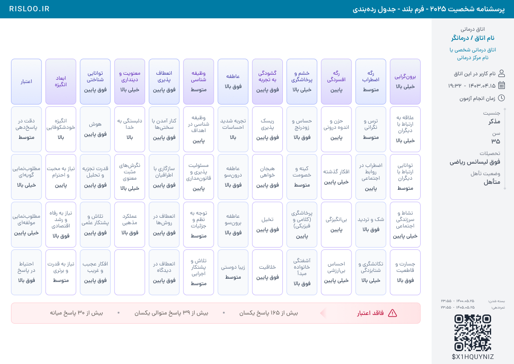
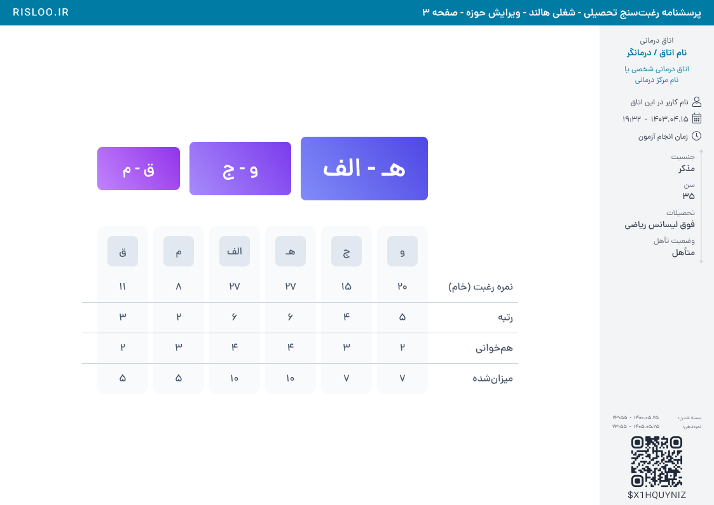
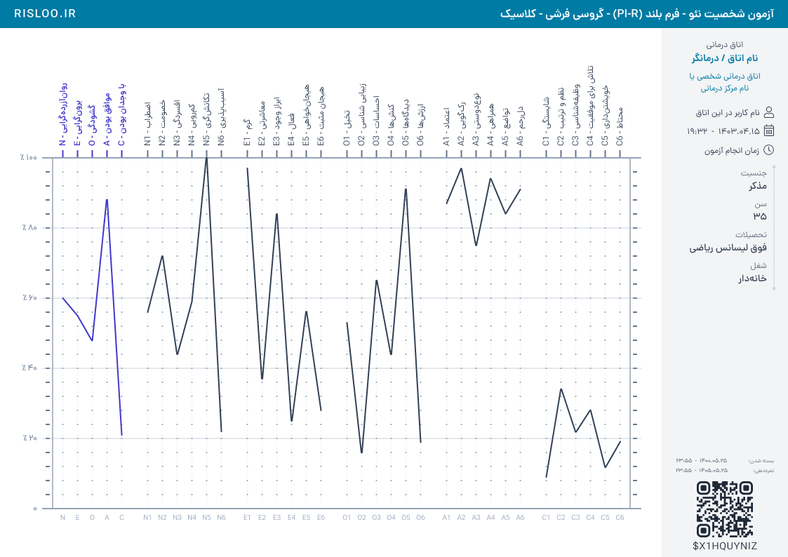
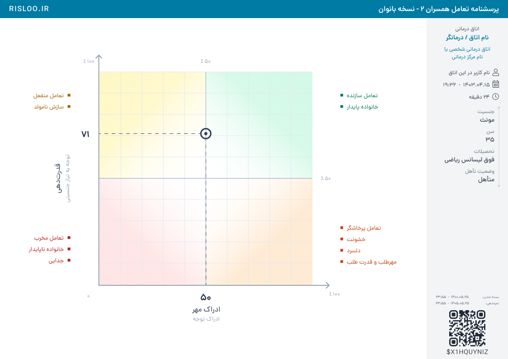
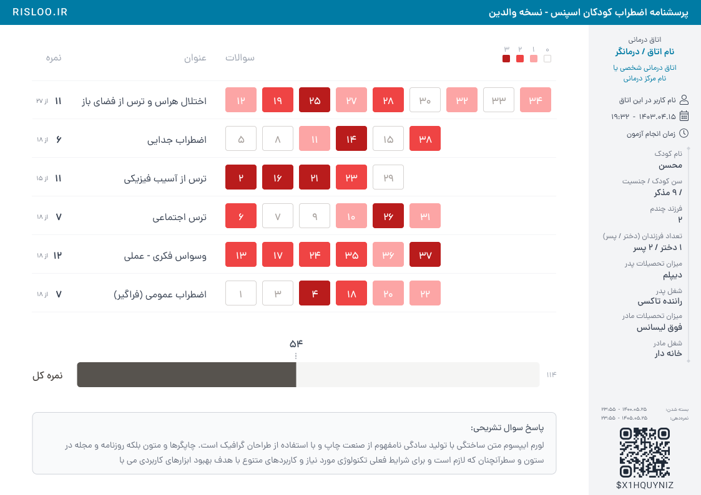

# جدول‌ها، نمودارهای ترکیبی، مختصات و نقشهٔ رنگ

بخشی از [راهنمای اصلی](../README.md). تمام اندازه‌ها در این سند **اندازهٔ نمونهٔ نام‌برده** هستند. منابع: PNG فیگما + هندسه و ویژگی‌های لایه‌های همان فایل؛ بررسی ۲۰۲۶-۱۰-۱۱. نمودارها فقط از نظر ظاهر بررسی شده‌اند.

## منابع جدید و پوشش

| سکشن | نمونهٔ پایین‌تر/جدیدتر | y در سکشن | نقش در راهنما |
|---|---|---:|---|
| CheckList | [شخصیت۲۰۲۵، جدول رده‌بندی](https://www.figma.com/design/Ev7eB2DQIWjRhIkFnqD38V/?node-id=6026-192563) | 4290 | جدول کارت‌ها و نوار هشدار |
| CheckList | [هالند حوزه، صفحه۳](https://www.figma.com/design/Ev7eB2DQIWjRhIkFnqD38V/?node-id=5961-168513) | 3448 | جدول خلوت و سلسله‌مراتب نتیجه |
| XY & Bubble | [NEO گروسی فرشی کلاسیک](https://www.figma.com/design/Ev7eB2DQIWjRhIkFnqD38V/?node-id=5978-206438) | 4016 | نمودار خطی چندگروهی |
| XY & Bubble | [NEO حق‌شناس کلاسیک](https://www.figma.com/design/Ev7eB2DQIWjRhIkFnqD38V/?node-id=5970-175784) | 3174 | نسخهٔ هم‌خانواده |
| Mix | [تعامل همسران بانوان، صفحه۲](https://www.figma.com/design/Ev7eB2DQIWjRhIkFnqD38V/?node-id=3-7388) / [آقایان](https://www.figma.com/design/Ev7eB2DQIWjRhIkFnqD38V/?node-id=3-7495) | 3448 | ماتریس دوبعدی و اطلاعات پیرامونی |
| Heat Maps | [اسپنس، نسخهٔ والدین](https://www.figma.com/design/Ev7eB2DQIWjRhIkFnqD38V/?node-id=3-16003) | 922 | شدت پاسخ، جمع و متن تشریحی |

هر چهار نمای کلی بررسی شدند: Mix شامل ۹ فریم، CheckList هشت، XY پنج و Heat Maps دو فریم تمام‌صفحه است. جدیدترین نمونه‌ها به اندازهٔ طبیعی جداگانه دیده و خواص منتخبشان خوانده شدند. در Heat Maps فقط دو نمونه وجود دارد؛ «جدیدتر در این سکشن» ادعای تازه‌بودن نسبت به کل فایل نیست. نمونهٔ NEO دیگری با شناسهٔ `5978:215205` بیرون سکشن XY در Profiles قرار دارد؛ ساختار و typography آن هم خوانده شد و در فهرست منابع جدا آمده است.

## جدول و کارت

### TAB-01 — واحد تکرار و فاصله‌ها را از ساختار جدول بگیرید

در شخصیت۲۰۲۵، Chart در Main با اندازهٔ `895×578` در `(24,88)` قرار دارد. Table برابر `895×516` است: پنج ردیف `100px` با شروع‌های `0,104,208,312,416`؛ فاصلهٔ عمودی `4px`. کارت نمونه `67.25×100` است و شروع ستون‌های نمونه `0,75.25,150.5,…` نشان‌دهندهٔ فاصلهٔ افقی `8px` است. شعاع کارت `8px`، stroke داخلی `1px` است.

**درست:** اندازه و راهنمای ثابت برای کارت‌های همان جدول. **نادرست:** تغییر ارتفاع هر کارت با کوتاه/بلند شدن عنوان یا اعمال فاصلهٔ عمودی ۸ چون فاصلهٔ افقی ۸ است.

### TAB-02 — عنوان، سطح و خانوادهٔ رنگ را در کارت قابل تشخیص نگه دارید

متن‌های جدول شخصیت۲۰۲۵ معمولاً `DanaFaNum Regular 12` برای عنوان، `Medium 12` برای سطح و line-height حدود `120%` دارند. عنوان و مقدار یک بلوک با فاصلهٔ `8px` می‌سازند و چندخطی شدن عنوان در همان قاب حل می‌شود. برخی باکس‌های مقدار RIGHT هستند، هرچند بلوک کلی در کارت وسط قرار دارد؛ مرکز بودن کارت به معنی CENTER بودن همهٔ متن‌ها نیست.

نمونهٔ کارت indigo: زمینهٔ `#F8FAFC → #E0E7FF`، border `#A5B4FC`، عنوان `#3730A3`. گروه بنفش نیز `#F1F5F9 → #DDD6FE` و عنوان `#5B21B6` دارد. متن عمومی `#334155` و متن ثانویه `#64748B` است. رنگ را به گروه مفهومی موجود وصل کنید، نه به شمارهٔ تصادفی ستون. این رنگ‌ها برای همین جدول‌اند.

**درست:** حفظ تراز بلوک و تمایز عنوان/سطح. **نادرست:** استنتاج «خیلی بالا همیشه رنگ قرمز می‌گیرد» از متن سطح.

### TAB-03 — هشدارِ تمام‌عرض به لبهٔ جدول وصل است

در همین نمونه، نوار `895×46` در `(0,532)` قرار دارد؛ فاصله از انتهای جدول `16px`. radius `8`، stroke داخلی `1px #FECDD3`، زمینه `#FFF1F2`. قسمت عنوان در سمت راست `190×46` است، فاصلهٔ آیکن از متن `8px` و جعبهٔ آیکن `22×22` است. بلوک دلایل `675×46` و جزء اتصال بین دلایل/عنوان جداست. متن عنوان «فاقد اعتبار» `Medium 14` است.

**درست:** حفظ پهنا و تراز هشدار با محتوا. **نادرست:** کپی‌کردن شرط اعتبار، تعداد دلایل یا متن‌های مثال به آزمون دیگر. در این تصویر فقط حالتِ وجود هشدار دیده می‌شود؛ رفتار حذف آن از همین PNG قابل تعیین نیست. برای نمونهٔ دارای شواهد هر دو حالت، [PSQI](../examples/recent-redesigns.md) را ببینید.

### TAB-04 — جدول خلوت به کادرکشی سنگین نیاز ندارد

هالند: مجموعهٔ `686×404` در `(129,175)` داخل Main. جدول در y=140 با اندازهٔ `686×264`؛ شش ستون `80×264` با فاصلهٔ `8px` و شروع‌های `0,88,…440` داخل قاب `520px`. عنوان ردیف‌ها در سمت راست و در چهار ردیف `48px` قرار دارد. زمینهٔ ستون‌ها `#F8FAFC`، باکس عنوان ستون `#E2E8F0` و متن `#475569` است؛ خطوط افقی ظریف ارتباط ردیف‌ها را حفظ می‌کنند.

**درست:** نوار زمینهٔ عمودی برای دنبال کردن ستون و خط ظریف مشترک برای ردیف. **نادرست:** افزودن grid سیاه و ضخیم به همهٔ سلول‌ها یا جابه‌جایی مقادیر مستقل از عنوان ردیف.

### TAB-05 — بزرگی نشان نتیجه، تأکید تعریف‌شده است

سه نشان هالند در یک قاب `520×100` هستند: `130×68` در y=16، `160×84` در y=8 و `200×100` در y=0؛ مرکز عمودی هر سه y=50 است. فاصلهٔ بین آن‌ها `15px` و radius هر سه `8px` است. فونت‌ها `DemiBold 24/28/40` و متن سفیدند. گرادیان‌های violet/indigo هر نشان جدا تعریف شده‌اند.

**درست:** تأکید با اندازه و رنگ در کنار مرکز مشترک. **نادرست:** تبدیل ارتفاع نشان‌ها به نمودار کمی یا نسبت دادن خودکار اندازه به یک نمرهٔ جدید. روابط رتبه/متن از دادهٔ آزمون می‌آیند.

## نمودار خطی و مختصات

### XY-01 — شکل نهایی را از تصویر بخوانید، نه عنوان سکشن

جدیدترین نمونه‌های XY & Bubble نمودار خطی NEO هستند؛ نباید صرفاً به دلیل نام سکشن به bubble تبدیل شوند. در نسخهٔ گروسی، Chart برابر Main `943×754` است، ولی قاب مجموعهٔ محتوا (All) برابر `885×649` در `(29,53)` است. «قاب Chart» و «قاب All» یکسان نیستند؛ این اندازه‌ها هم ادعای اندازه‌گیری مرز پیکسل‌های رنگ‌شده نیستند. دو بار حاشیه اضافه نکنید.

### XY-02 — راهنمای بصریِ شبکه از خط نتیجه ضعیف‌تر باشد

در NEO کلاسیک، خطوط نتیجهٔ گروه‌ها پررنگ‌اند: گروه اصلی indigo `#4338CA` و گروه‌های دیگر `#334155`. شبکه/راهنما از `#F1F5F9` و `#94A3B8` و نوشته‌های فرعی از `#64748B` استفاده می‌کند. بخش‌ها با فضای خالی و قطع مسیر بین گروه‌ها تفکیک می‌شوند؛ اتصال گروه‌های مستقل با یک polyline سراسری ظاهر و معنای نمودار را عوض می‌کند.

**درست:** سلسله‌مراتب شبکه → tick → نتیجه. **نادرست:** پررنگ‌کردن همهٔ خطوط یا رسم یک مسیر پیوسته از انتهای یک گروه به ابتدای بعدی.

### XY-03 — دو ردیف عنوان نقش متفاوت دارند

در NEO، عناوین بالایی شامل کد و نام کامل‌اند و متن چرخیده است؛ پایین نمودار کدهای کوتاه قائم هستند. در All، Top Titles در `(54,0)` با اندازهٔ `807×115` و Bottom Titles در `(54,641)` با اندازهٔ `807×8` است. عناوین اصلی `Dana DemiBold 12` با رنگ indigo و عناوین زیرمقیاس `Dana Regular 12` با رنگ تیره‌اند؛ line-height حدود `110%`. کدهای پایین `Dana Regular 10` هستند. این تفاوت برای هدایت خواندن است.

**درست:** کد و عنوان به محور همان مقیاس متصل باشند. **نادرست:** چرخاندن کل صفحه برای تقلید چرخش عنوان‌ها یا استفادهٔ اجباری از فونت عددی برای کد `N1`.

### XY-04 — منطقه، نقطهٔ نتیجه و راهنمای آن را تفکیک کنید

در Mix، آخرین صفحهٔ تعامل همسران یک ماتریس مربع `471×471` است. چهار زمینهٔ کم‌رنگ، خط‌های میانی، شبکهٔ ظریف و نشانهٔ حلقوی نتیجه لایه‌های جدا هستند. خط‌چین‌های نتیجه به محورهای مرتبط می‌رسند و مقدار خوانده‌شده کنار محور نوشته می‌شود. توضیح ناحیه‌ها خارج از مربع و با رنگ مرتبط قرار دارد؛ رنگ زمینه از مرکز به بیرون شدت می‌گیرد.

All نسخهٔ بانوان `(63,81,817,592)` و نسخهٔ آقایان `(63.5,81,816,592)` است. این اختلاف نیم‌پیکسلی/یک‌پیکسلی دلیل کافی برای «تصحیح خودکارِ مرکز» نیست. عددها و مرکز نشان از همان مختصات داده می‌آیند؛ حد منطقه‌ها یا عنوانشان از این مطالعه تغییر نمی‌کند.

**درست:** رنگ کم‌رنگ برای منطقه و نشان مشخص برای نتیجه. **نادرست:** جایگزینی نشان نتیجه با رنگ کل منطقه یا استنتاج فرمول از موقعیت یک نقطهٔ نمونه.

## نمودار ترکیبی و نقشهٔ رنگ

### MIX-01 — چند جزء با جداسازی روشن و مقیاس‌های مستقل

مرور Mix نشان می‌دهد یک صفحه می‌تواند ستون، حلقه، جدول و نمرهٔ کل داشته باشد؛ گروه‌بندی با فضای سفید، divider یا کارت انجام شده است. صفحه‌های پایین تعامل همسران، توضیحات و نمودار را در ناحیه‌های روشن جدا می‌کنند. یک استایل واحد به همهٔ جزءها تحمیل نکنید: پالت و مقیاس هر جزء باید ارتباط خودش با محتوا را حفظ کند. طرح قدیمیِ بسیار فشردهٔ رغبت‌سنج در بالای سکشن، پیش‌فرض تراکم برای صفحهٔ تازه نیست.

### HEAT-01 — رنگ شدت با راهنمای صریح و عدد خوانا

در اسپنس، پاسخ هر سؤال در یک سلول `50×40` با شمارهٔ سؤالِ وسط نشان داده می‌شود. pitch افقی نمونه `59px`، یعنی فاصلهٔ `9px`؛ شروع ردیف‌ها y=`100,162,224,286,348,410`، یعنی pitch عمودی `62px`. شماره‌ها `DanaFaNum Medium 16` هستند. چهار حالت با زمینهٔ سفید/خنثی و طیف `#FCA5A5`، `#EF4444`، `#B91C1C` متمایزند؛ شماره روی زمینهٔ پررنگ سفید است و راهنمای کوچک `12×12` بالای ردیف‌ها دیده می‌شود.

**درست:** در همین خانواده راهنما با رنگ سلول منطبق باشد و شماره خوانا بماند. **نادرست:** تعمیم این چهار رنگ به اعتبار همهٔ آزمون‌ها یا استخراج نمرهٔ پاسخ از تیرگی بدون منبع نمره‌دهی.

### HEAT-02 — ردیف متغیر، ستون‌های اطلاعات ثابت

تعداد سلول‌ها در ردیف‌های اسپنس متفاوت است؛ عنوان، مقدار و «از حداکثر» روی راهنماهای ثابت می‌مانند. عنوان و نمرهٔ ردیف `16px` هستند، «از …» در همان ردیف `10px`. خط‌های جداکننده حدود `840px` پهنا دارند. سلول اضافی برای پرکردن ردیف کوتاه تولید نکنید.

### HEAT-03 — جمع و پاسخ تشریحی، بلوک‌های مستقل و هم‌عرض

در Main اسپنس، Total در `(51.5,501)` به اندازهٔ `840×80` و Descriptive Answer در `(51.5,621)` به اندازهٔ `840×100` قرار دارد. بین انتهای Total و باکس پاسخ `40px` فاصله است. باکس پاسخ radius `8px`، stroke داخلی `1px #D1D5DB` و زمینهٔ `#F9FAFB` دارد. متن راست‌چین و چندخطی است؛ نمرهٔ جمع روی میله و متن آزاد در باکس خودش می‌ماند.

**درست:** هم‌عرضی بلوک‌ها و جداسازی نقش عدد/متن. **نادرست:** کوچک‌کردن خودسرانهٔ فونت برای متن بلند، بریدن آن یا ساختن قاعدهٔ حذف پاسخ از همین نمونهٔ ثابت. رفتار overflow در پیاده‌سازی آینده باید جدا تعیین شود.

## محدودیت‌های تعمیم

این نمونه‌ها مرجع چیدمان هستند. قرارداد کارت `67.25×100`، گام `48` جدول، گام `62` پاسخ‌ها، چهار رنگ پاسخ و شبکهٔ `471×471` اعداد سراسری پروژه نیستند. چیدمان فاقد هشدارِ شخصیت۲۰۲۵، مقدارهای مرزی و نمودار با تعداد متفاوت مقیاس از این PNGها اثبات نمی‌شود. قبل از پیاده‌سازی چنین حالت‌هایی به مشخصات همان آزمون برگردید.
